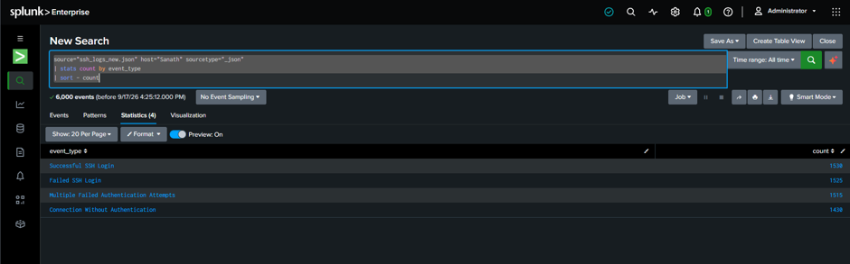
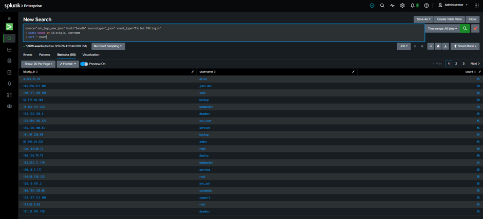
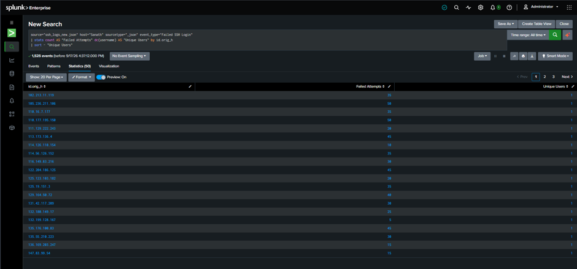
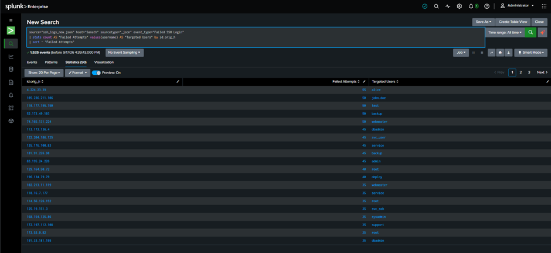
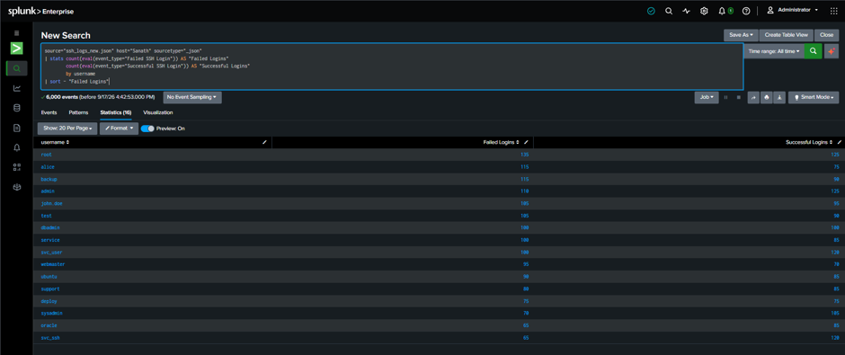
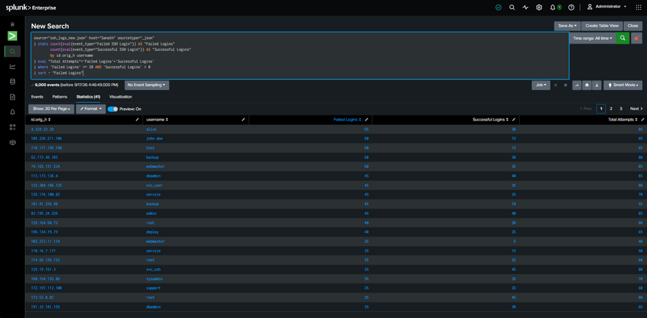

# 🔐 Splunk SSH Authentication Security Monitoring

<p align="center">


</p>

<p align="center">
<b>Splunk-based SSH authentication log analysis, suspicious activity detection and SOC-style investigation.</b>
</p>

---

## 📌 Project Overview

This project demonstrates a practical **SOC / Blue Team security monitoring workflow** using **Splunk Enterprise**.

SSH authentication events are analyzed with **Splunk Search Processing Language (SPL)** to identify failed authentication attempts, successful logins, source IP activity, targeted accounts and potentially suspicious authentication patterns.

The repository contains the SPL queries used during the investigation and the corresponding Splunk screenshots.

---

## 🎯 Objectives

- Analyze SSH authentication logs in Splunk
- Identify repeated failed authentication attempts
- Analyze source IP addresses
- Identify targeted usernames
- Correlate failed and successful authentication
- Detect potentially suspicious authentication patterns
- Develop brute-force triage logic
- Practice SOC investigation and event triage
- Document findings in a GitHub-ready format

---

## 🛠️ Tools & Technologies

| Technology | Purpose |
|---|---|
| 🔥 Splunk Enterprise | SIEM & Security Monitoring |
| 🔎 SPL | Log Searching & Detection |
| 🔐 SSH | Authentication Event Source |
| 🐧 Linux | Security Environment |
| 🐙 GitHub | Documentation & Portfolio |

---

## 📊 Dataset

The project uses simulated SSH authentication data ingested into Splunk.

### Event Types

```text
Successful SSH Login
Failed SSH Login
Multiple Failed Authentication Attempts
Connection Without Authentication
```

### Dataset Statistics

The supplied Splunk investigation screenshots show **6,000 events** in total.

| Event Type | Count shown in Splunk |
|---|---:|
| Successful SSH Login | 1,530 |
| Failed SSH Login | 1,525 |
| Multiple Failed Authentication Attempts | 1,515 |
| Connection Without Authentication | 1,430 |
| **Total Events** | **6,000** |

> ⚠️ The dataset is simulated/educational data created for cybersecurity laboratory practice.

---

# 🔎 Investigation Methodology

The investigation follows a simplified SOC workflow:

```text
SSH AUTHENTICATION LOGS
          ↓
EVENT CLASSIFICATION
          ↓
FAILED LOGIN ANALYSIS
          ↓
SOURCE IP ANALYSIS
          ↓
TARGETED USER ANALYSIS
          ↓
FAILED + SUCCESSFUL CORRELATION
          ↓
SUSPICIOUS ACTIVITY DETECTION
          ↓
SOC INVESTIGATION
```

---

# 🚨 Detection Approach

The main triage condition used in this project is:

```text
Failed Logins >= 20
AND
Successful Logins > 0
```

This pattern can warrant investigation for:

- 🔐 Password guessing
- 🚨 Brute-force activity
- 🔑 Possible credential compromise
- 🤖 Automated authentication attempts

> ⚠️ This is a triage heuristic and does not independently prove compromise.

---

# 🧪 SPL Queries

## 1️⃣ Event Type Analysis

```spl
source="ssh_logs_new.json" host="Sanath" sourcetype="_json"
| stats count by event_type
| sort - count
```

## 2️⃣ Failed SSH Login Analysis

```spl
source="ssh_logs_new.json" host="Sanath" sourcetype="_json" event_type="Failed SSH Login"
| stats count by id.orig_h, username
| sort - count
```

## 3️⃣ Source IP Analysis

```spl
source="ssh_logs_new.json" host="Sanath" sourcetype="_json" event_type="Failed SSH Login"
| stats count AS "Failed Attempts" dc(username) AS "Unique Users" by id.orig_h
| sort - "Unique Users"
```

## 4️⃣ Targeted User Analysis

```spl
source="ssh_logs_new.json" host="Sanath" sourcetype="_json" event_type="Failed SSH Login"
| stats count AS "Failed Attempts" values(username) AS "Targeted Users" by id.orig_h
| sort - "Failed Attempts"
```

## 5️⃣ Failed vs Successful Authentication

```spl
source="ssh_logs_new.json" host="Sanath" sourcetype="_json"
| stats count(eval(event_type="Failed SSH Login")) AS "Failed Logins"
        count(eval(event_type="Successful SSH Login")) AS "Successful Logins"
        by username
| sort - "Failed Logins"
```

## 6️⃣ Suspicious Authentication Detection

```spl
source="ssh_logs_new.json" host="Sanath" sourcetype="_json"
| stats count(eval(event_type="Failed SSH Login")) AS "Failed Logins"
        count(eval(event_type="Successful SSH Login")) AS "Successful Logins"
        by id.orig_h username
| eval "Total Attempts"='Failed Logins'+'Successful Logins'
| where 'Failed Logins' >= 20 AND 'Successful Logins' > 0
| sort - "Failed Logins"
```

## 7️⃣ Timeline Analysis

```spl
source="ssh_logs_new.json" host="Sanath" sourcetype="_json" event_type="Failed SSH Login"
| timechart span=1m count
```

> The supplied screenshots show highly concentrated event timestamps, so timeline visualization can appear within a small number of time buckets.

---

# 🔥 Key Findings

The supplied Splunk screenshots show:

```text
Total Events:                      6,000
Successful SSH Logins:             1,530
Failed SSH Logins:                 1,525
Multiple Failed Authentication:    1,515
Unauthenticated Connections:       1,430
```

### High-Failure Source/User Combinations

Examples visible in the suspicious-activity investigation include:

| Source IP | Username | Failed | Successful | Total |
|---|---|---:|---:|---:|
| 4.224.23.39 | alice | 55 | 30 | 85 |
| 105.236.211.106 | john.doe | 50 | 15 | 65 |
| 110.177.195.150 | test | 50 | 15 | 65 |
| 52.173.49.103 | backup | 50 | 30 | 80 |
| 74.165.131.224 | webmaster | 50 | 35 | 85 |
| 113.173.136.4 | dbadmin | 45 | 35 | 80 |
| 122.204.186.125 | svc_user | 45 | 30 | 75 |
| 135.176.100.83 | service | 45 | 35 | 80 |

These combinations were surfaced by the project's triage query because they contain repeated failures together with successful authentication.

---

# 🧠 SOC Analyst Investigation

A high number of failed logins alone does not prove malicious activity.

A SOC analyst should correlate:

```text
Source IP
    ↓
Target Username
    ↓
Failed Attempts
    ↓
Successful Authentication
    ↓
Timestamp
    ↓
Destination Host
    ↓
Post-Authentication Activity
```

If suspicious activity is confirmed, possible response actions include:

1. Investigate the source IP
2. Validate the targeted account
3. Review successful login timestamps
4. Check authentication methods
5. Review post-login activity
6. Investigate privilege escalation
7. Reset potentially compromised credentials
8. Terminate suspicious sessions
9. Block malicious infrastructure where appropriate
10. Escalate the incident

---

## 🧰 Detection Engineering & SOC Triage

Companion documents to extend this project with alert logic, validation, and incident documentation:

- [Detection Rules, Alert Triage & False-Positive Analysis](docs/detection-rule-and-false-positive-analysis.md)
- [Sample SOC Incident Report Template](reports/sample-soc-incident-report-template.md)

The detection threshold is an educational starting point. Validate event ordering, timestamp parsing, and environment context before treating a search result as an incident.

---

# 📄 Splunk Investigation Report

The complete Splunk monitoring report is included as a PDF export. It contains the event-type analysis, source-IP analysis, failed-login analysis, targeted-user visualization, failed-vs-successful authentication visualization, suspicious-authentication visualization, and timeline analysis. fileciteturn10file0L3-L11

[View the Splunk Monitoring Report](reports/ssh_logs_monitoring-2026-09-17.pdf)

# 📸 Investigation Screenshots

## Event Type Analysis



## Failed SSH Login Analysis



## Source IP Analysis



## Targeted Users



## Failed vs Successful Authentication



## Suspicious Activity



> **Dashboard screenshot:** A dedicated dashboard image was not included in the supplied screenshots, so no dashboard screenshot has been fabricated in this repository.

---

# 📁 Project Structure

```text
splunk-ssh-authentication-security-monitoring/
│
├── README.md
│
├── dashboard/
│   └── README.md
│
├── reports/
│   └── ssh_logs_monitoring-2026-09-17.pdf
│
├── spl_queries/
│   ├── 01_event_type_analysis.spl
│   ├── 02_failed_login_analysis.spl
│   ├── 03_source_ip_analysis.spl
│   ├── 04_targeted_users.spl
│   ├── 05_failed_vs_successful.spl
│   ├── 06_suspicious_activity.spl
│   └── 07_timeline_analysis.spl
│
├── screenshots/
│   ├── 01_event_type_analysis.png
│   ├── 02_failed_login_analysis.png
│   ├── 03_source_ip_analysis.png
│   ├── 04_targeted_users.png
│   ├── 05_failed_vs_successful.png
│   └── 06_suspicious_activity.png
│
├── sample_data/
│   └── README.md
│
├── .gitignore
└── LICENSE
```

---

# 🎓 Skills Demonstrated

- Splunk Enterprise
- SPL Query Development
- SIEM Monitoring
- SSH Authentication Analysis
- Source IP Investigation
- Account Targeting Analysis
- Brute-Force Detection
- Event Correlation
- Security Event Triage
- SOC Investigation
- Security Dashboard Analysis
- Security Documentation

---

# 🚀 Future Improvements

- Real-time Splunk alerts
- Automated notable events
- GeoIP enrichment
- Threat intelligence integration
- Risk-based alerting
- MITRE ATT&CK mapping
- Automated response workflows
- Advanced authentication anomaly detection
- Production-style timestamp analysis
- Dedicated SOC dashboard export

---

# ⚠️ Disclaimer

This project is intended for:

- Cybersecurity education
- SIEM training
- SOC analyst practice
- Blue Team learning
- Portfolio demonstration

The dataset used in this project is simulated/educational data.

Do not use security testing techniques against systems or accounts without proper authorization.

---

# 👨‍💻 Author

## Sanath Bansod

**Cybersecurity | VAPT | SOC | SIEM | Security Operations**

---

<p align="center">

### 🔐 Learn → Detect → Investigate → Respond

</p>
